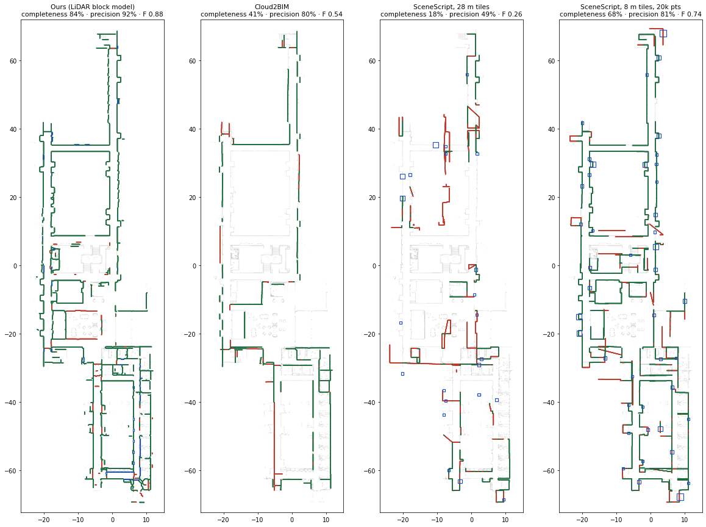

# Blunt Hall 3D

A web viewer for handheld LiDAR scans of the inside of Blunt Hall, captured with a GeoCue **TrueView GO** (Go116S: Hesai 16-beam rotating LiDAR, three 5 MP fisheye cameras).

**Live site:** https://shanem73.github.io/Blunt_hall_3D/

**Route guide:** https://shanem73.github.io/Blunt_hall_3D/guide.html — opens on a 3D campus map of Missouri State with Roy Blunt Hall highlighted; click the building to go inside, where a clean block model gives step-by-step directions from the front entrance to Room 319 (`guide.html#route` opens the building directly).

Use the **Scan** and **View** selectors in the side panel to switch between scans, floors and areas (Stairwell, Entrance).

| Scan | Coverage | Raw data |
|---|---|---|
| **4 Nov 2026** (default) | Complete 3rd floor, the central stairwell through all floors, part of the 1st floor and the entrance outside. Floors are 3.65 m apart; the 2nd and 4th floors are only stair landings · 902 m walk, 945 s, 11 loop closures | 93.7 M points, 5,745 photos |
| 29 Oct 2026 | One corridor segment of the main level · 67 m walk, 245 s | 19.5 M points, 1,487 photos |

| View | 4 Nov 2026 | 29 Oct 2026 |
|---|---|---|
| LiDAR points | 10.0 M denoised, people-free, clutter-free points on a 3 cm grid, one file per floor or area | 2.5 M points, 1.5 cm |
| Colored points | Colored from 5,745 photos, with exposure and white balance equalized per photo (±13 %) | 1,487 photos (±9 %) |
| SLAM map | One floor plan per level, with the walk on that floor | One floor plan |
| 3D model | Tiled screened-Poisson mesh of the cleaned cloud: 11.1 M triangles at full resolution, 6.7 M on the web, split by floor and area | 1.8 M triangles |
| Building model | SketchUp-style structural model: 4,266 flat wall, floor and ceiling rectangles with door openings, photo-textured at 2 cm per texel. The stairwell keeps its measured mesh. **Walk in the building** (first person, WASD). One glTF 2.0 file per floor, ready for Blender, Unity or Unreal. **Blender scenes** with 159 furniture objects (SAM 3 + SAM 3D) are in the [release](https://github.com/ShaneM73/Blunt_hall_3D/releases/tag/blender-2026-11-04) | — |
| Gaussian splat | Training (added in a follow-up) | 664 k Gaussians |

No build step is needed: the site is static HTML + three.js. To preview it locally, run `python3 -m http.server` and open `http://localhost:8000`.

## How the raw data was read

TrueView GO projects are normally processed in GeoCue's TrueView EVO software. These viewers were built straight from the raw project folder by reverse-engineering its files:

| File | Format |
|---|---|
| `SLAM_DATA/TMP_0000N.bin` | One or more segments, read in order. Each has a 128-B header (`ffaa`, n_frames, record size = 20) · per-frame index `(u32 n_points, u32 unix_s)` · point records at byte 24128: `f32 x,y,z` (body frame), `f32 t`, `u8 intensity`, `u8 ring`, `u16 0` |
| `SLAM_DATA/slam_optimized_trajectory.tra` | XOR 0x53, then 14 × float64 per frame: `t, x, y, z, qw, qx, qy, qz, …` (body → world) |
| `IMG/CameraN/CameraN.cam` | Concatenated JPEGs, each preceded by `0xAAAAAAAA` + `"<unix_time>.jpg"` |
| `IMG/CameraN/CAM-N.CP` | Protobuf: field 8 = `fx, fy, cx, cy`; field 9 = Kannala–Brandt fisheye `k1–k4`; field 10 = mount angles. Fields 10.4–6 are intrinsic **ZYX** Euler angles (rad) giving body→camera, and 10.7–9 is the camera offset in the body frame (m) |

The camera-extrinsic convention was confirmed by photometric consistency: the same 3D point should have the same color in different photos. All three cameras picked the same convention, and refinement moved the angles by less than 2°.

## Repository layout

```
index.html, app.js, style.css    web viewer
data/datasets.json               list of scans shown in the viewer
data/<scan>/                     web data for one scan (meta.json, points_*.bin, mesh_*.ply, slam_map_*.png, trajectory.json, *.splat)
scripts/tvgo/                    raw-format readers (read_tvgo.py, pb.py protobuf dump, calib.py camera calibration)
scripts/pipeline/                processing pipeline for any scan (below)
scripts/legacy/                  the scripts used for the first version of the 29 Oct scan (v1/, hq/), kept for reference
scripts/tools/shot.py            headless screenshots of the viewer for checking
raw/      (git-ignored)          raw TrueView GO project folders, one per scan
work/     (git-ignored)          per-scan working data: decoded/ calib/ clouds/ color/ mesh/ images/ splat/ renders/ logs/
```

## Pipeline (`scripts/pipeline/`)

Put the raw project folder in `raw/`, then run the stages from `scripts/pipeline/`. Named areas (stairwell, entrance) and the outdoor range boxes are defined in `work/<scan>/regions.json`; the copy used for 4 Nov is in `scripts/pipeline/regions/`.

```bash
DATASET=2026-11-04-142939 . ./env.sh          # sets TVGO_RAW, BH_WORK=work/<DATASET>, CUDA paths
python s01_decode.py && python s02_refine_poses.py && python s02b_align_reregister.py
python s03_hq_cloud.py && python s04_carve.py && python s05_images.py && python s06_colorize.py
python s07_person_rm.py && python s07b_clean.py && python s08_mesh.py && python s09_splat.py
BH_VOXEL=3 BH_FLOOR_NAMES="1st floor|2nd floor (stair landing)|3rd floor|4th floor (stair landing)" python s10_web.py 2026-11-04 "<title>"
python s11_splat_export.py 2026-11-04 && python s12_structure.py && python s13_texture.py 2026-11-04
```

| Stage | What it does |
|---|---|
| `s01_decode` | Decodes the trajectory and all `TMP_*.bin` point files, registers every frame into the world frame, indexes the JPEGs inside the `.cam` files (no extracted copies), and draws an overview |
| `s02_refine_poses` | Aligns 3 s submaps with point-to-plane ICP and optimizes them in a pose graph |
| `s02b_align_reregister` | Removes the rigid drift the pose graph adds (0.38° on 4 Nov), keeping only the real correction (2.8 cm mean), then re-registers all points |
| `s03_hq_cloud` | Keeps returns 0.5–6 m from the scanner and within 5 m of the path on a 1 cm grid. Removes outliers using local planes fitted on a 2.5 cm grid and pulls planar points onto their surface |
| `s04_carve` | Free-space carving: a point that a laser beam later passed through belonged to a moving person |
| `s05_images` | Undistorts photos to pinhole 1458×1944 and makes Mask R-CNN person masks |
| `s06_colorize` | Visibility per photo (z-buffer from the cloud plus that moment's raw returns), a gain per photo and channel against the blend, then a sharper best-view final blend |
| `s07_person_rm` | Removes person blobs that carving missed, e.g. someone standing still |
| `s07b_clean` | Removes clutter: **reflections** (a beam cannot pass through a measured floor or ceiling, so returns beyond one are mirror images from glossy floors or glass), points never seen as the front surface, small floating fragments, and **sparse streaks** of distant surfaces caught by only a few LiDAR rings (3.6 % in total on 4 Nov) |
| `s08_mesh` | Screened Poisson in 16 m tiles (~9 mm cells), trimmed to within 3 cm of real points |
| `s09_splat` | Gaussian splat (gsplat) with LiDAR depth supervision and per-image exposure correction. Photos stay in pinned CPU memory, so the photo count isn't limited by GPU memory |
| `s12_structure` | Structural model. Wall faces are found per orientation on the building axes (dominant wall direction), chained into straight faces, and get door openings and headers. Floor and ceiling slabs are rectangles from the occupancy grids. Stair boxes keep the measured mesh |
| `s13_texture` | Photo textures for the structural faces at 2 cm per texel (visibility, people masks and exposure gains as in s06; mean pass, then a best-view pass), packed into 4096² atlases and exported as one glTF per floor (Y-up) |
| `s10_web` | Detects floors from up-facing surfaces under the walk and ceilings from down-facing ones, then writes per-floor points, mesh pieces and floor plans |
| `s11_splat_export` | Exports `.splat` files per floor (≤ 2.9 M Gaussians each, under GitHub's 100 MB file limit) |

The robust wall noise is 0.5–2 cm (0.64 cm median on 4 Nov), which is the Hesai sensor's level.

### Furniture objects and Blender model (`scripts/pipeline/objects/`)

Three Python environments: the pipeline venv (`env.sh`), the SAM 3 conda env, and the [SAM 3D Objects](https://github.com/facebookresearch/sam-3d-objects) conda env (its gated checkpoints need Hugging Face access). Blender 4.2 LTS runs headless.

```bash
cd ~/sam3 && BH_WORK=... BH_SHARD=0 BH_NSHARD=2 ~/.conda/envs/sam3/bin/python .../objects/s14_sam3_detect.py   # one shard per GPU
python objects/s15_lift_objects.py && python objects/s16_object_meshes.py && python objects/s18_pick_views.py
cd ~/apps/sam-3d-objects && BH_WORK=... ~/.conda/envs/sam3d-objects/bin/python .../objects/s19_sam3d.py
python objects/s20_fit_sam3d.py
blender -b -P objects/s17_blender.py -- data/2026-11-04 $BH_WORK/objects/meshes $BH_WORK/blender
```

| Stage | What it does |
|---|---|
| `s14_sam3_detect` | SAM 3 text prompts (chair, table, desk, sofa, cabinet, shelf, trash can, monitor, bench, stool, …) on every undistorted photo; one index mask + detections per photo |
| `s15_lift_objects` | Projects the clean LiDAR points into each photo (z-buffered) and votes on labels (≥ 35 % of ≥ 3 views); drops points on structural faces; connected components on a 5 cm grid → 162 instances |
| `s16_object_meshes` | Cuts each instance's triangles out of the measured mesh (vertex colours) |
| `s18_pick_views` | Picks, per object, the photo where it is largest and fully covered by one SAM 3 detection of its label |
| `s19_sam3d` | SAM 3D Objects: a complete mesh from that photo + mask (15–40 s each on an A100); vertex colours from its own Gaussians |
| `s20_fit_sam3d` | Places the SAM 3D mesh on the LiDAR: yaw + uniform scale + position, bottom on the floor, 108 starts refined by trimmed ICP. Accepted when ≥ 60 % of the LiDAR points lie within 3 cm (96 of 158 on 4 Nov) |
| `s17_blender` | One `.blend` per floor + one for the whole building: collections Structure (textured glb), Stairs, Furniture (by type, SAM 3D mesh or LiDAR cut-out, property `source`), corridor camera, Cycles settings and an `unlit` scene switch. Published as a [GitHub release](https://github.com/ShaneM73/Blunt_hall_3D/releases/tag/blender-2026-11-04) |

### Route guide (`scripts/pipeline/guide/`, `guide.html`)

```bash
DATASET=2026-11-04-142939 . scripts/pipeline/env.sh
BH_SHARD=0 BH_NSHARD=2 python scripts/pipeline/guide/g01_ocr_signs.py          # one shard per GPU (EasyOCR)
cd ~/sam3 && PYTHONPATH=~/sam3 BH_SHARD=0 BH_NSHARD=2 ~/.conda/envs/sam3/bin/python .../guide/g01b_sam3_signs.py
python scripts/pipeline/guide/g02_signs.py && python scripts/pipeline/guide/g03_blocks.py
BH_ROOM=319 BH_ROOM_REF=323:2 python scripts/pipeline/guide/g04_route.py   # 319 = two doors from the 323 sign towards the stairs
```

| Stage | What it does |
|---|---|
| `g01_ocr_signs` | Reads text in every photo (EasyOCR) |
| `g01b_sam3_signs` | SAM 3 boxes for "room number sign" / "door sign" (finds the small signs the OCR detector misses) |
| `g02_signs` | Re-reads each sign at high zoom (digits only), places it in 3D by casting a ray onto the LiDAR, and votes over all views of the same sign |
| `g03_blocks` | Block model from the structural faces: 15 cm walls on a 5 cm grid in the building frame, split into boxes; floor slabs as outline polygons |
| `g04_route` | Shortest path over the scan walk from outside the front doors to the room's door sign (or, when the sign could not be read, counted in doors from a read sign: the recessed 0.9 m door pieces of the wall, one every 2.75 m on the 3rd floor); the stairs become 4 straight flights on the building axes (17 cm block steps) joined by flat landing plates, and the route follows their centre lines; the room becomes a block behind its sign; wherever the walk passes through a wall block (doors the scanner saw closed, e.g. the glass vestibule doors) a 1.4 m doorway is cut |

The page (`guide.html`, `guide.js`) draws the blocks with three.js, gives each step its distance and walking time (1.3 m/s on the level, 0.55 m/s on the stairs; the steps add up to the total), shows live distance / time in a panel that travels beside the walker, with a report per stage, during **Walk the route**, shows a "Roy Blunt Hall" monument sign outside the front doors, the office owner's GitHub headshot (`assets/shane.jpg`) standing in the room, and turns the route into directions (turns, distances, which side the door is on).

Campus map data (`data/campus/msu-map.json`, from the [MSU Campus Atlas](https://shanem73.github.io/msu-campus-atlas-2026/)) is © OpenStreetMap contributors under the [Open Database License](https://www.openstreetmap.org/copyright); OpenStreetMap still names Roy Blunt Hall "Temple Hall".

### Comparison with Meta SceneScript and Cloud2BIM (`scripts/pipeline/compare/`)

**Interactive page:** https://shanem73.github.io/Blunt_hall_3D/compare.html · **Findings and data:** [release compare-2026-11-07](https://github.com/ShaneM73/Blunt_hall_3D/releases/tag/compare-2026-11-07)

The 3rd floor (19 M clean LiDAR points, about 37 m × 137 m) was turned into walls by three methods and every result
was scored the same way against the measured wall surfaces, on the floor plan (2.5 cm grid), so thick walls (blocks,
IFC solids) and thin wall planes count alike:

- **completeness**: share of LiDAR points on vertical surfaces 0.3–2.0 m above the floor within 10 cm of a modelled wall
- **precision**: share of each model's wall centre line within 10 cm (+ half the local wall thickness) of such a point

| Method | Completeness | Precision | F | Wall length | Doors | Run time |
|---|---|---|---|---|---|---|
| **Ours** (LiDAR block model, `s12` + `g03`) | **84 %** | **92 %** | **0.88** | 847 m | 41 openings | — |
| [Cloud2BIM](https://github.com/VaclavNezerka/Cloud2BIM) (density histograms + morphology → IFC) | 41 % | 80 % | 0.54 | 439 m | 0 | 7 min 15 s (CPU) |
| [SceneScript](https://github.com/facebookresearch/scenescript), non-Manhattan model, 28 m tiles | 18 % | 49 % | 0.26 | 445 m | 24 | 45 s (A100) |
| SceneScript, 12 m tiles, 20k points per tile | 59–60 % | 76–78 % | 0.66–0.68 | 890–920 m | 22–23 | 76 s |
| SceneScript, 10 m tiles, 20k points | 69 % | 75 % | 0.72 | 1,084 m | 39 | 94 s |
| **SceneScript, 8 m tiles, 20k points** (best) | 68 % | 81 % | 0.74 | 987 m | 43 | 110 s |



Green: modelled wall on a measured wall; red: no measured wall within the tolerance; blue: doors / openings; grey: LiDAR wall points.
All scores: `docs/compare/scores_3rd_floor.json`.

Findings
- **SceneScript** is trained on room-sized, sparse Aria "semi-dense" point clouds. It handles at most a 32 m cube, so the floor is
  cut into overlapping tiles (a wall or door is kept by the tile whose centre region holds its midpoint). Room-sized tiles matter
  most: F rises from 0.26 (28 m tiles) to 0.74 (8 m); thinning each tile to 15–30k points changes little. Repeat runs differ by
  about 0.02 in F (the decoder samples). Some tiles return nothing, and 2 of 131 crashed inside the decoder. Its walls are thin
  planes, often slightly off the real face or extended across open areas (the red lines).
- **Cloud2BIM** gets the long corridor walls right but misses the central light-well block and most interior partitions, and finds no
  openings ("no openings detected" for every wall). It needed three changes (`cloud2bim.patch`): its slab detector requires a
  ceiling layer with ≥ 60 % of the floor's point density, while a handheld scan sees the ceiling at ~40 %, so the threshold was
  lowered to 35 %; LaTeX in its plots was turned off; and its room-zone (IfcSpace) step, which crashed, was made non-fatal.
  7 of its 101 IFC walls do not triangulate.
- **Ours** uses the scan's own geometry (wall faces fitted in s12, 15 cm blocks in g03) and so follows the real walls best. Closed doors
  that sit flush with the wall are hard for every method: of the 8 known office doors on the Room 319 wall, SceneScript finds 0–2,
  ours and Cloud2BIM 0 (the guide places Room 319 by the door spacing instead, `g04`).

Reproduce (after `c01_export.py` and the block model):
```bash
DATASET=2026-11-04-142939 . scripts/pipeline/env.sh
BH_FLOOR=2 python scripts/pipeline/compare/c01_export.py          # clean storey -> cloud2bim.xyz, points.npz, walls_ref.npz
BH_FLOOR=2 python scripts/pipeline/compare/c02_ours.py
# Cloud2BIM (git clone VaclavNezerka/Cloud2BIM; git apply cloud2bim.patch; env with its requirements.txt)
python cloud2entities.py scripts/pipeline/compare/cloud2bim_f2.yaml
BH_FLOOR=2 BH_C2B_SECONDS=435 <cloud2bim env>/python scripts/pipeline/compare/c02_cloud2bim.py
# SceneScript (facebookresearch/scenescript env with torchsparse from its master branch = 2.1; weights from projectaria.com/scenescript,
# CC BY-NC, kept in work/models/scenescript/)
cd scenescript && BH_FLOOR=2 BH_SS_CKPT=... BH_SS_TILE=8 BH_SS_STRIDE=5 BH_SS_MAXPTS=20000 BH_SS_TAG=t8-20k <scenescript env>/python .../c04_scenescript.py
BH_FLOOR=2 BH_CMP_PLOT=ours,cloud2bim,scenescript,scenescript-t8-20k python scripts/pipeline/compare/c03_score.py
BH_FLOOR=2 python scripts/pipeline/compare/c05_web.py          # data/compare/ for compare.html (plan viewer)
BH_FLOOR=2 python scripts/pipeline/compare/c06_web3d.py        # data/compare/ 3D wall models + wall points (3D section)
```

## Known limitations

- Coordinates are local SLAM metres for each scan (no GNSS indoors), so the two scans are not in a common frame. Z is up.
- People who walked alongside the operator were removed (photo masks + LiDAR carving), but faint smudges and one person standing still near the stairs remain.
- Furniture: SAM 3D predicts the sides the photo didn't show, so backs are plausible rather than measured. Objects whose fit was poor (often several pieces merged into one instance, or partly hidden) keep the rough LiDAR cut-out. Glass walls are flat textured panels in the building model.
- The Gaussian splat looks best from viewpoints near the walking path. Far from it (or in corners the cameras barely saw) it becomes blurry or hazy.
- The points and mesh cover only areas within 5 m of the walking path. Rooms seen only through doorways were left out. On 4 Nov, Level −1 and Level +1 were reached only by the stairs, so they are partial.
